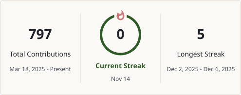

<h1 align="center">Hi, I'm Aitor</h1>

  <a href="https://aitorias.is-a.dev">
    <picture>
      <source media="(prefers-color-scheme: dark)" srcset="https://readme-typing-svg.demolab.com?font=Fira+Code&size=22&duration=3000&pause=1000&color=A4D09C&center=true&vCenter=true&width=550&lines=Front-End+Developer;Accessible%2C+high-performance+web+apps;Astro+%2B+React+%2B+TypeScript+%2B+Tailwind" />
      
    </picture>
  </a>

  

    
    
    
  

## About me

- I build **accessible, fast web applications** with a focus on type safety and clean, maintainable architecture.
- Lately I've been working on **healthcare analytics**: a React + Supabase product for Irish GP practices, shipped as a web app and an Electron desktop app.
- I care about the details: **security headers and CSP**, i18n, Core Web Vitals, and a strict lint/format/test pipeline in CI.
- Spanish 🇪🇸 from **Barcelona**, living in **Mallow, Ireland** since November 2025.

## Featured projects

<table>
  <tr>
    <td width="50%" valign="top">
      <h3>CDM Optimiser</h3>
      
Healthcare analytics for Irish GP practices. It finds patients who are eligible for the Chronic Disease Management programme but not yet enrolled, and turns that gap into a prioritised recall workflow with revenue projections.

      
<b>Role:</b> Lead developer 
      <b>Stack:</b> React · TypeScript · Vite · TanStack Query · Supabase · Tailwind · Electron · Vitest · Playwright

      
<a href="https://cdm-optimiser.netlify.app">Live</a> · <a href="https://github.com/CDM-Optimiser/cdm-optimiser">Code</a>

    </td>
    <td width="50%" valign="top">
      <h3>Portfolio</h3>
      
My personal site: a multilingual Astro site with a Japanese-pastel design system, light/dark themes and GA4 offloaded to a web worker with Partytown.

      
<b>Stack:</b> Astro v7 · Tailwind CSS v4 · TypeScript · i18n · Partytown · Oxc

      
<a href="https://aitorias.is-a.dev">Live</a> · <a href="https://github.com/aitoriasdev/aitoriasdev.github.io">Code</a>

    </td>
  </tr>
</table>

## Tech stack

  

## GitHub activity

  <a href="https://github.com/aitoriasdev">
    <picture>
      <source media="(prefers-color-scheme: dark)" srcset="https://raw.githubusercontent.com/aitoriasdev/aitoriasdev/output/stats-dark.svg" />
      
    </picture>
  </a>
  <a href="https://github.com/aitoriasdev">
    <picture>
      <source media="(prefers-color-scheme: dark)" srcset="https://raw.githubusercontent.com/aitoriasdev/aitoriasdev/output/top-langs-dark.svg" />
      
    </picture>
  </a>
   
  <a href="https://github.com/aitoriasdev">
    <picture>
      <source media="(prefers-color-scheme: dark)" srcset="https://raw.githubusercontent.com/aitoriasdev/aitoriasdev/output/streak-dark.svg" />
      
    </picture>
  </a>

